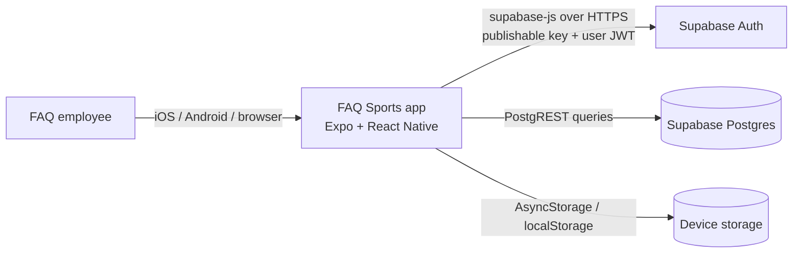
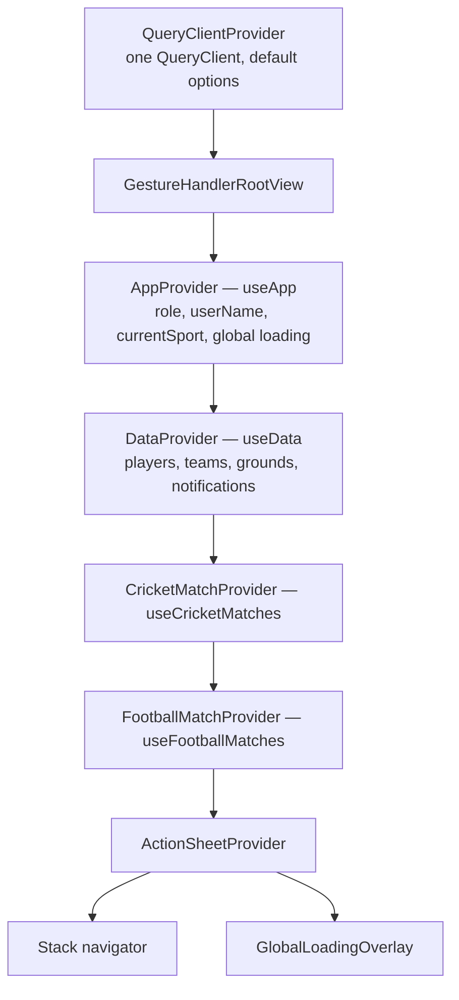
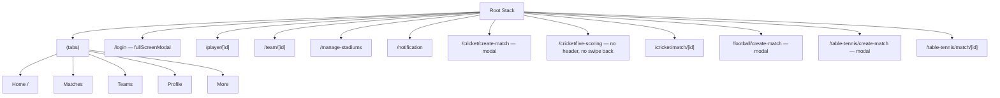
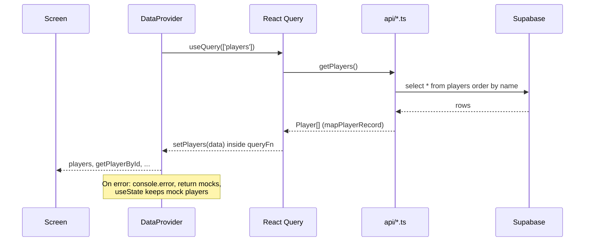
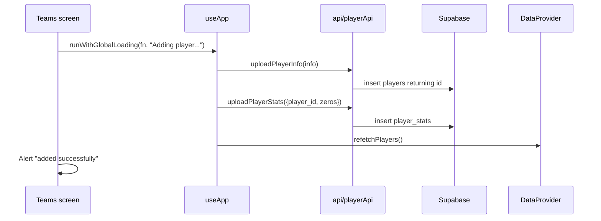
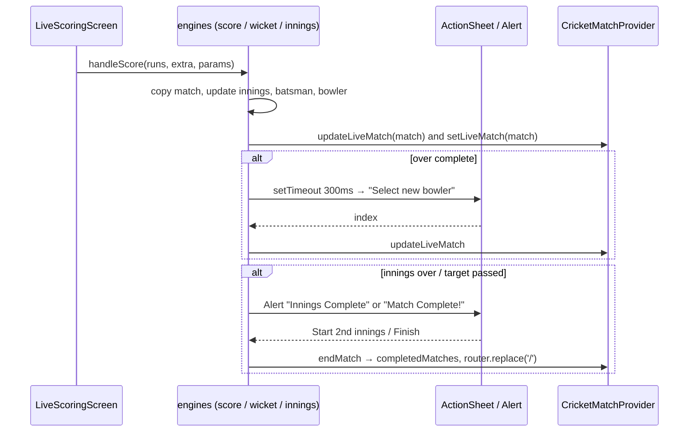

# FAQ Sports — Architecture

**Last updated:** 2026-11-19 (from source at commit `1f86ac9`)

Related: [COMPONENTS.md](COMPONENTS.md) · [API_DOCUMENTATION.md](API_DOCUMENTATION.md) · [DATABASE_SCHEMA.md](DATABASE_SCHEMA.md) · [AUTHENTICATION.md](AUTHENTICATION.md)

## 1. System context



- Supabase is the only backend. There are no custom servers, Edge Functions, storage buckets or realtime channels referenced in the code (whether any exist in the Supabase project is **Unknown**).
- The client talks to Supabase directly with the publishable (anon) key. Security therefore depends on Supabase Row Level Security, which is not in this repo ([AUTHENTICATION.md §5](AUTHENTICATION.md#5-authorization)).

## 2. Folder layout

```
app/                 Expo Router routes ONLY (every file is a URL)
  _layout.tsx        Root Stack, provider tree, global loading overlay
  (tabs)/            Home (index), matches, teams, profile, more
  login.tsx  manage-stadiums.tsx  notification.tsx
  player/[id].tsx  team/[id].tsx
  cricket/           one-line re-exports of sports/cricket/screens/*
  football/          one-line re-export
  table-tennis/      one-line re-export
sports/<sport>/      everything for one sport
  screens/ components/ engines/ api.ts context.tsx types.ts constants.ts
api/                 shared Supabase access: supabaseClient, auth, team, player, ground
context/AppContext.tsx   AppProvider/useApp and DataProvider/useData
types/               shared domain types and Supabase row payload types
constants/colors.tsx colour tokens (theme.ts is an unused Expo template file)
hooks/               Expo template colour-scheme hooks (unused)
mocks/data.ts        mock players, teams, matches, notifications, grounds
__tests__/           Jest tests
```

Rules (from [`CLAUDE.md`](../CLAUDE.md)):

- Code used by one sport goes in `sports/<sport>/`. Shared code goes in `api/`, `context/`, `types/`, `constants/`.
- Screens live in `sports/<sport>/screens/`; a route file in `app/<sport>/` re-exports them: `export { default } from '@/sports/cricket/screens/CreateMatchScreen';`
- Never put non-route files under `app/`.
- Screens call `api/*` or context hooks, never `supabase` directly. This holds today.

## 3. Runtime structure

### 3.1 Provider tree

Defined in `app/_layout.tsx`:



A new sport's provider goes into this chain. Details of each hook are in [COMPONENTS.md §3](COMPONENTS.md#3-context-hooks).

### 3.2 State layers

| Layer | Holds | Lifetime |
|-------|-------|----------|
| React Query cache | `init` (stored role/name/sport), `teams`, `players`, `grounds` | App session; `staleTime` 5 min (teams, players), 10 min (grounds) |
| `useState` in providers | Copies of the query data, plus matches and notifications | App session |
| AsyncStorage | `user_role`, `user_name`, `current_sport` | Survives restarts |
| Supabase client memory | Auth session | On web: `localStorage` (supabase-js default). On native: probably memory only ([AUTHENTICATION.md §4](AUTHENTICATION.md#4-session-handling)) |
| Screen `useState` | Form inputs, "This Over" strip, comments | Screen lifetime |

`DataProvider` copies React Query results into `useState`. Both exist, so there are two sources of truth for teams and players. The `useState` copies start as **mock data** and keep it if the fetch fails.

## 4. Navigation

Expo Router with `typedRoutes` on. The root is a `Stack`; `(tabs)` is a bottom tab navigator.



| Route | Screen file | Admin only in UI | Route guard |
|-------|-------------|------------------|-------------|
| `/` | `app/(tabs)/index.tsx` | no | redirects to `/login` when no cached role |
| `/matches` | `app/(tabs)/matches.tsx` | no | none |
| `/teams` | `app/(tabs)/teams.tsx` | add/delete buttons | none |
| `/profile` | `app/(tabs)/profile.tsx` | admin section | none |
| `/more` | `app/(tabs)/more.tsx` | Admin Tools section | none |
| `/login` | `app/login.tsx` | no | none |
| `/player/[id]` | `app/player/[id].tsx` | no | none |
| `/team/[id]` | `app/team/[id].tsx` | no | none |
| `/manage-stadiums` | `app/manage-stadiums.tsx` | yes (link only shown to admins) | **none** |
| `/notification` | `app/notification.tsx` | no | none |
| `/cricket/create-match` | `sports/cricket/screens/CreateMatchScreen.tsx` | yes | **none** |
| `/cricket/live-scoring` | `sports/cricket/screens/LiveScoringScreen.tsx` | yes | **none** |
| `/cricket/match/[id]` | `sports/cricket/screens/MatchDetailsScreen.tsx` | Start/Continue scoring button | none |
| `/football/create-match` | `sports/football/screens/CreateMatchScreen.tsx` | yes | **none** |
| `/table-tennis/create-match` | `sports/table-tennis/screens/CreateMatchScreen.tsx` | yes | in screen ("Admins only") |
| `/table-tennis/match/[id]` | `sports/table-tennis/screens/ScorecardScreen.tsx` | scoring controls only | read-only for players; RLS limits writes to admins |
| `+not-found` | `app/+not-found.tsx` | | |
| `+native-intent` | `app/+native-intent.tsx` (passes deep links through unchanged) | | |

## 5. Data flows

### 5.1 Reading shared data



### 5.2 Writing shared data



There is no transaction: if the second insert fails, the player exists without a stats row.

### 5.3 Cricket live scoring



Nothing in this flow writes to Supabase. See [BUSINESS_LOGIC.md](BUSINESS_LOGIC.md) for the rules.

## 6. Cross-cutting concerns

| Concern | How it's done today |
|---------|---------------------|
| Loading | `runWithGlobalLoading(fn, message)` shows a full-screen overlay. It doesn't block touches (`pointerEvents="box-none"`). |
| Errors | API functions `console.error` and re-throw; screens catch and show `Alert.alert('Error', ...)`. No error boundary. |
| User prompts | `Alert.alert` and `showActionSheetWithOptions`, chained with `setTimeout(…, 300)`. `Alert` buttons don't work on web. |
| Haptics | `triggerHaptic()` in `scoreEngine.ts`, skipped on web. |
| Config | `EXPO_PUBLIC_SUPABASE_PUBLISHABLE_KEY` (required), `EXPO_PUBLIC_SUPABASE_URL` (optional). The client throws at import if the key is missing. |
| Build | Expo CLI only. No `eas.json`, no CI config. `app.json` enables `typedRoutes`, `reactCompiler` and the new architecture. Web output is `static`. |

## 7. Architectural decisions found in code

These are not written down anywhere else.

| Decision | Consequence |
|----------|-------------|
| One context provider per sport for matches. | Football's provider is a copy of cricket's. A generic match context would remove the duplication. |
| Scoring rules live in engine files that receive callbacks (`ScoreEngineParams`, `WicketEngineParams`, `InningsEngineParams`). | The rules are out of the screen, but the engines still call `Alert`, action sheets and `setTimeout`, so they can't be unit-tested without mocks. |
| Engines mutate nested state and rely on that mutation. | See [BUSINESS_LOGIC.md §6](BUSINESS_LOGIC.md#6-known-defects), defect C4. |
| Mock data seeds real providers. | The app looks populated when Supabase fails or is empty, which hides errors. |
| Grounds are referenced by name, not ID. | Renaming a ground would break references in saved matches (once matches are saved). |
