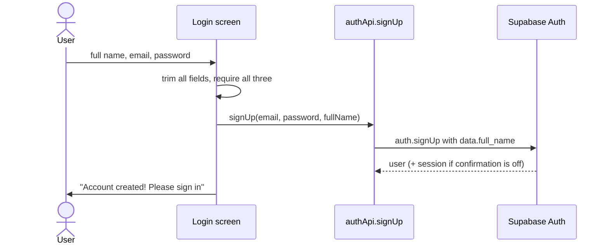
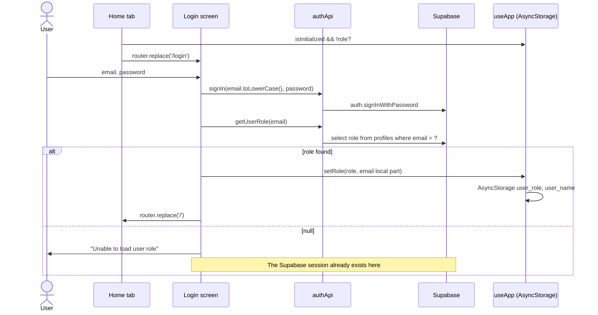
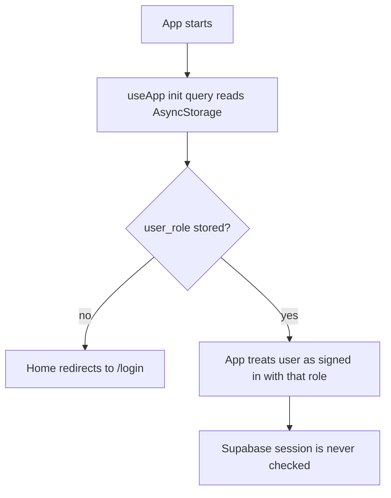

# FAQ Sports — Authentication and Authorization

**Last updated:** 2026-11-19 (from source at commit `1f86ac9`)

Related: [API_DOCUMENTATION.md](API_DOCUMENTATION.md#4-request-examples) · [DATABASE_SCHEMA.md](DATABASE_SCHEMA.md#31-profiles) · [ARCHITECTURE.md](ARCHITECTURE.md#4-navigation) · [PROJECT_AUDIT.md §9](PROJECT_AUDIT.md#9-authentication-and-authorization)

## 1. Summary

| Aspect | Implementation |
|--------|----------------|
| Identity provider | Supabase Auth, email + password |
| Role source | `profiles.role`, looked up by email after sign-in |
| Roles | `admin`, `player` (`UserRole` in `types/index.ts`) |
| Role storage on device | AsyncStorage key `user_role` (on web: `localStorage`) |
| Session storage | supabase-js default; not configured for React Native |
| Route protection | Home tab only |
| Server-side authorization | RLS policies exist but **none checks the admin role**, and users can set their own role to `admin` ([DATABASE_SCHEMA.md §7.3](DATABASE_SCHEMA.md#73-row-level-security-policies)) |

## 2. Sign-up



- Anyone can sign up with any email today. **Intended rule (decided 2026-11-19):** only company email addresses. This must be enforced server-side (for example a Supabase Auth hook or a trigger on `auth.users`); a check in the login screen alone can be bypassed. No restriction is visible in the RLS policies; what `handle_new_user()` does is **Unknown**. That trigger runs on every sign-up and is a good place to enforce the rule (raising an exception rolls the sign-up back).
- `full_name` goes into the auth user's metadata. The `on_auth_user_created` trigger runs `handle_new_user()` on sign-up, which presumably creates the `profiles` row (`id` = auth user ID) and copies the name; the role it sets is **Unknown**.
- The password is `.trim()`med, so leading or trailing spaces are dropped.
- Password rules (length etc.) are whatever the Supabase project enforces.

## 3. Sign-in



- The user name shown in the app is the part of the email before `@` (for example `jane.doe`), not the full name entered at sign-up.
- If the role lookup fails, the user is signed in to Supabase but not to the app.

## 4. Session handling

### 4.1 On launch



`getCurrentUser()` exists but is never called. The app never asks Supabase whether the session is still valid.

### 4.2 Session persistence

**Fixed 2026-11-23:** `api/supabaseClient.ts` now passes `auth: { storage: AsyncStorage (native only), autoRefreshToken: true, persistSession: true, detectSessionInUrl: web only }`, so the session survives restarts on iOS/Android. Users who signed in before this change must sign out and in once. Previously (no `auth` options) supabase-js only persisted the session in `localStorage`:

| Platform | Expected behaviour |
|----------|-------------------|
| Web | Session saved in `localStorage`; survives reloads. |
| iOS / Android | No `localStorage`, so the session is probably memory-only. After a restart the cached role says "signed in" but requests go out without a user token. **Confirm on a device.** |

The usual React Native setup passes AsyncStorage and turns off URL session detection:

```ts
createClient(url, key, {
  auth: { storage: AsyncStorage, autoRefreshToken: true, persistSession: true, detectSessionInUrl: false },
});
```

This is not in the code today.

### 4.3 Logout

`useApp().logout()`:

- removes `user_role` and `user_name` from AsyncStorage,
- clears role and name in state.

It does **not** call `signOut()`, clear the React Query cache, or reset `current_sport`. The Supabase session stays valid in the client until it expires.

## 5. Authorization

### 5.1 How the client decides

```ts
const isAdmin = role === 'admin';   // context/AppContext.tsx
```

`role` comes from AsyncStorage. A user who edits local storage (easy on web) becomes an admin in the UI.

### 5.2 What `isAdmin` controls

| Screen | Admin-only UI |
|--------|---------------|
| Home | Create Match button; role badge colour |
| Teams | `+` (add team / add player), swipe-to-delete, change team |
| Profile | Admin section (Create Match, Manage Players, Tournaments); hides own stats |
| More | Admin Tools: Manage Matches, Manage Teams, Manage Stadiums |
| Match Details | Start Match / Continue Scoring buttons |

### 5.3 What is not protected

- **Routes:** `/cricket/create-match`, `/cricket/live-scoring`, `/football/create-match`, `/table-tennis/create-match` and `/manage-stadiums` open for anyone who knows the URL or deep link, signed in or not.
- **Database writes:** every request carries the publishable key and (when present) the user's token. The RLS policies ([DATABASE_SCHEMA.md §7.3](DATABASE_SCHEMA.md#73-row-level-security-policies)) don't check the admin role anywhere:
  - any signed-in user can insert teams and grounds;
  - team delete is allowed for one hard-coded user ID only, so other admins' deletes silently do nothing;
  - `players` and `player_stats` have no insert policy; whether RLS is on for them is **Unknown**;
  - **any signed-in user can update their own `profiles.role` to `admin`**, and the app will treat them as admin on next sign-in.

### 5.4 What RLS needs to enforce

Target policies implied by the app's roles, compared with what exists today. The existing policies are listed in [DATABASE_SCHEMA.md §7.3](DATABASE_SCHEMA.md#73-row-level-security-policies), with a sketch of the fix (an `is_admin()` helper and a lock on `role`).

| Table | Read | Write |
|-------|------|-------|
| `profiles` | Own row (exists) | Own `full_name` / `avatar_url` / `favorite_team_id` only; **never `role`** (today: any column) |
| `teams`, `players`, `player_stats`, `player_ratings`, `grounds` | Signed-in users (today: everyone, including signed out) | Admins only (today: teams/grounds insert by any signed-in user, team delete by one user, nothing else) |
| `matches`, `match_squads`, `innings`, `innings_extras`, `batting_scorecards`, `bowling_scorecards`, `fall_of_wickets`, `ball_events` | Signed-in users | Admins only, or the assigned scorer ([REQUIREMENTS.md open question 14](REQUIREMENTS.md#7-open-questions)) (today: read-only for everyone) |

## 6. Identity and the player record

There is no link between an auth user and a `players` row. The Profile tab picks the user's player like this:

```ts
players.find(p => p.name.toLowerCase().includes(userName.toLowerCase().split(' ')[0])) || players[0];
```

Because `userName` is the email local part (`jane.doe`), this matches any player whose name contains `jane.doe`, which usually fails, and then falls back to **the first player in the list**. Users can see someone else's stats as their own. See [REQUIREMENTS.md open question 12](REQUIREMENTS.md#7-open-questions).

## 7. Security findings

| # | Finding | Severity |
|---|---------|----------|
| S0 | **Any signed-in user can make themselves admin** by updating their own `profiles.role` (RLS policy "Users update own profile" allows every column). Fix written in `supabase/migrations/20261119000000_lock_profile_role.sql`, **not applied yet**. | **Critical** |
| S1 | Authorization is client-only: admin routes unguarded, and no RLS policy checks the admin role. | Critical |
| S2 | Session not persisted on native. **Fixed 2026-11-23** (AsyncStorage storage in `supabaseClient.ts`). | High |
| S3 | Logout doesn't call `signOut`. | Medium |
| S4 | Role lookup by email. Works because RLS returns only the caller's own row; looking up by `id = auth.uid()` would be more robust. | Low |
| S5 | Open sign-up, but the business rule is company emails only. | Medium |
| S6 | Password trimmed. | Low |
| S7 | `getUserRole` logs the profile row; `getMatches` logs match names. | Low |
| S8 | Client key handling is correct; no secrets in git history. | OK |
| S9 | All queries use the query builder (parameterised); no HTML injection surface. | OK |
| S10 | Profile tab can show another user's stats. | Medium (privacy) |
| S11 | Teams, players, stats, matches, scorecards and tournaments are readable without signing in, by anyone with the publishable key. | Medium (decision: is this data internal?) |
| S12 | Team delete is tied to one hard-coded user ID instead of the admin role. | High |

## 8. Key handling rules

From [`CLAUDE.md`](../CLAUDE.md):

- The key comes from `.env` (git-ignored); copy `.env.example`.
- Never commit `.env`, never hard-code or log the key.
- Never put a secret or `service_role` key in the app. Anything with `EXPO_PUBLIC_` is bundled into the client and is public.
- Restart with `npx expo start -c` after changing `.env`.
