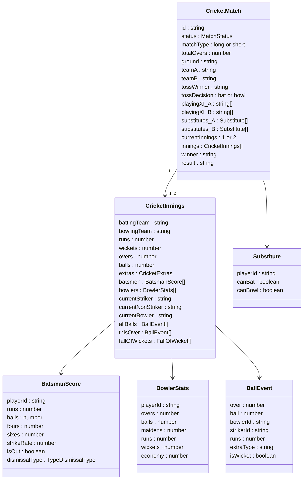
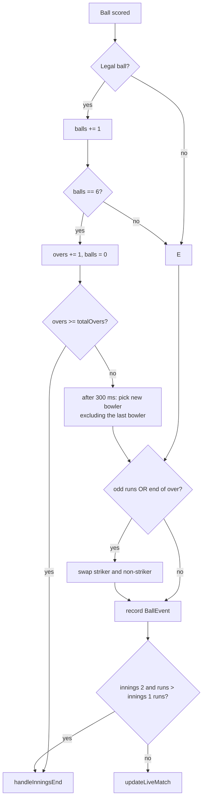
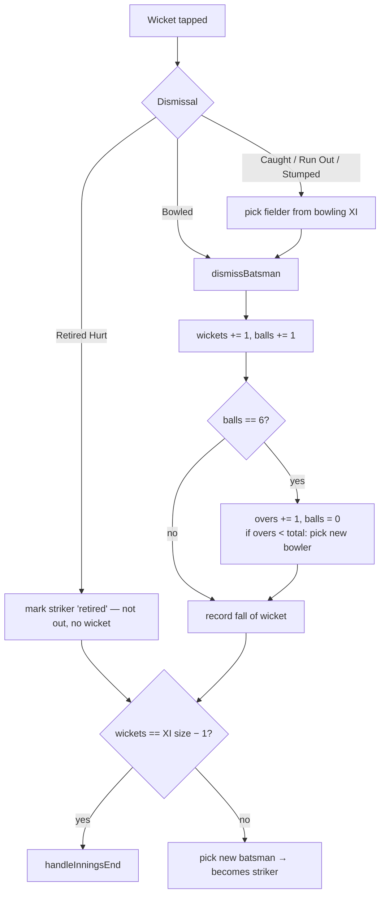

# FAQ Sports — Business Logic

**Last updated:** 2026-11-19 (from source at commit `1f86ac9`)

Related: [REQUIREMENTS.md](REQUIREMENTS.md) · [COMPONENTS.md §6](COMPONENTS.md#6-cricket-engines-non-ui-modules) · [DATABASE_SCHEMA.md](DATABASE_SCHEMA.md) · [PROJECT_AUDIT.md §10](PROJECT_AUDIT.md#10-business-logic)

This page describes the rules **as the code implements them today**, including where they differ from standard cricket. Where the intended rule is unclear, it links to the open questions in [REQUIREMENTS.md §7](REQUIREMENTS.md#7-open-questions). Nothing here is persisted to Supabase yet; all match logic runs in memory.

## 1. Where the logic lives

| Logic | File |
|-------|------|
| Runs, extras, over completion, strike rotation, chase check, undo, haptics | `sports/cricket/engines/scoreEngine.ts` |
| Dismissal menu, fielder pick, dismissal, new batsman, new bowler | `sports/cricket/engines/wicketEngine.ts` |
| Openers for innings 2, innings end, result, manual end, swap strike, new bowler | `sports/cricket/engines/inningsEngine.ts` |
| Match setup validation, toss, team order | `sports/cricket/screens/CreateMatchScreen.tsx` |
| Scorecard text, target / runs needed | `sports/cricket/screens/MatchDetailsScreen.tsx`, `components/LiveMatchCard.tsx` |
| Player stat mapping, defaults | `api/playerApi.ts` `mapPlayerRecord` |
| "Top players" per sport | `app/(tabs)/index.tsx` `getPlayerStat` |

## 2. Cricket data model

Types in `sports/cricket/types.ts`.



Notes on the model:

- `id` is generated as `match_<timestamp>`.
- `teamA` is always the side batting first (§3.2).
- `ground` is the ground's name, not an ID.
- `thisOver` is never written; the screen keeps its own "This Over" list.
- `BatsmanScore` also has `dismissedBy`, `caughtBy`, `runoutBy`, `stumpedBy`; `BowlerStats` also has `wides`, `noBalls`.

`overs` and `balls` are kept separately: 3 overs and 4 balls is `overs: 3, balls: 4` (shown as `3.4`).

## 3. Match setup (Create Match)

### 3.1 Steps and validation

| Step | Inputs | Can continue when |
|------|--------|-------------------|
| Basics | Match type (Long / Short Pitch, default Long), total overs (default `10`), players per side (default `7`), ground | Type, overs and ground are set (no range check on overs or players) |
| Teams | Team A, Team B | Both chosen and different |
| Toss | Toss winner, decision (bat / bowl) | Both chosen |
| Players | Playing XI for each side, substitutes, 2 opening batsmen, opening bowler | Each XI has 2 to N players, XI + substitutes ≤ N per side, exactly 2 openers, 1 bowler (N = players per side) |

- Only players whose `teamId` is the chosen team appear in that team's XI list.
- Substitutes come from players in neither team. Each is assigned to one side with "Bat & Bowl", "Bat Only" or "Bowl Only". Adding is refused if that side is already at N.
- Match type is a label only; it changes no rule in code ([open question 3](REQUIREMENTS.md#7-open-questions)).

### 3.2 Toss and team order

```
battingTeam = decision == 'bat' ? tossWinner : the other team
```

When the match is created, if the batting team isn't Team A, Team A and Team B (and their XIs and substitutes) are **swapped**. After this, `teamA` is always the side batting first. The result logic depends on this.

### 3.3 Save or start

- **Save as Upcoming:** added to the front of `upcomingMatches`.
- **Start Now:** set as `currentMatch` with `status: 'live'`, then go to Live Scoring. It is not added to `liveMatch` until the first ball is scored.
- Starting an upcoming match from Match Details sets `currentMatch` but doesn't remove it from `upcomingMatches`.

## 4. Live scoring

### 4.1 Scoring controls

| Control | Engine call |
|---------|-------------|
| 0, 1, 2, 3, 4, 6 | `handleScore(runs)` |
| Wide, No Ball, Bye, Leg Bye | `handleExtra(type)` → "No Extra Runs" / "Add Extra Runs" → `handleScore(runs, type)` |
| Wicket | `handleWicket` → dismissal menu |
| Swap strike | `swapStrike` |
| Change bowler | `selectNewBowler` |
| Undo | `handleUndo` |
| End match (X) | `handleEndMatch` |

### 4.2 Runs and extras (`handleScore`)

`runs` is the number the scorer entered. `totalRuns` is what is added to the team.

| Delivery | Team runs | Extras column | Legal ball? | Batsman runs | Batsman balls | Bowler runs |
|----------|-----------|---------------|-------------|--------------|---------------|-------------|
| Normal | `runs` | — | yes | `+runs` | +1 | `+runs` |
| Wide | `runs + 1` | wides +1, total `+1+runs` | no | — | — | `+runs+1` |
| No ball | `runs + 1` | noBalls +1, total +1 | no | `+runs` | +0 | `+runs+1` |
| Bye | `runs` | byes `+runs` | **no** (C2) | — | — | **`+runs`** (C3) |
| Leg bye | `runs` | legByes `+runs` | **no** (C2) | — | — | **`+runs`** (C3) |

Fours and sixes are counted when `runs` is exactly 4 or 6 and the ball counts for the batsman (normal or no ball).

**Intended rule (decided 2026-11-19):** follow standard cricket. Byes and leg byes count as legal balls and are not charged to the bowler. The bold cells above are the gap between the code and this rule.

### 4.3 Over and strike



Strike swaps on odd `runs` for any delivery type (so a wide with 1 extra run swaps), and at the end of every over.

### 4.4 Derived figures

| Figure | Formula in code |
|--------|-----------------|
| Batsman strike rate | `runs / balls × 100` (first ball as a new entry: `runs × 100`) |
| Bowler economy | `runs / (overs + balls/6)`, divisor 1 if zero |
| Bowler overs | `overs + floor(balls/6)`, `balls % 6` |
| Maidens | Never calculated (always 0) |
| Fall of wicket overs | `overs + balls/10` (e.g. 3.4) |

### 4.5 Wickets



Rules in the code:

- **Bowler gets the wicket** for bowled, caught, stumped and hit wicket; not for run out.
- The dismissed batsman's balls +1; the bowler's balls +1. No runs are scored on a wicket ball.
- The new batsman always takes strike.
- **All out** is `XI size − 1` wickets. This is the intended rule (decided 2026-11-19).
- A retired batsman can be picked again later ([open question 5](REQUIREMENTS.md#7-open-questions)).
- The menu offers Bowled, Caught, Retired Hurt, Run Out, Stumped. Hit Wicket is supported by the types but not offered ([open question 9](REQUIREMENTS.md#7-open-questions)). LBW is supported by the database (`dismissal_type` enum) but not by the app at all ([open question 19](REQUIREMENTS.md#7-open-questions)).
- Run out always dismisses the striker; there's no way to run out the non-striker.
- No `BallEvent` is created for a wicket.

### 4.6 Bowler changes

- At the end of each over (if overs remain), and on "Change bowler", the scorer picks from the bowling XI **excluding the current bowler**.
- There is no limit on overs per bowler ([open question 8](REQUIREMENTS.md#7-open-questions)).
- Substitutes are never offered as bowlers or batsmen, whatever their rights ([open question 7](REQUIREMENTS.md#7-open-questions)).

### 4.7 Undo

The confirm says "Max 2 balls can be undone", but undo only removes the last item from the screen's "This Over" strip. Score, balls, extras and player figures are **not** reverted, and there's no limit ([open question 6](REQUIREMENTS.md#7-open-questions)).

## 5. Innings and result

### 5.1 End of innings 1

Triggered by overs running out or all out. An alert shows "`<team>` scored R/W" with one button, "Start 2nd Innings". Innings 2 is created with batting and bowling sides swapped, then the scorer picks striker, non-striker and bowler from action sheets. `currentInnings` becomes 2.

### 5.2 End of match

Triggered in innings 2 by overs running out, all out, or the chasing side passing the first-innings total.

| Situation | Code result |
|-----------|-------------|
| Team A (batted first) scored more | "`<A>` won by `<A − B>` runs" |
| Team B scored more | "`<B>` won by `<XI_A size − B wickets>` wickets" (C8: should use B's XI size − 1 − wickets) |
| Scores equal | Team B declared winner (C9). **Intended (decided 2026-11-19):** prompt the scorer to end the match as a draw/tie or play a super over. Super over rules are still open ([open question 16](REQUIREMENTS.md#7-open-questions)). |

"Finish" calls `endMatch` (moves the match to completed) and returns to Home.

### 5.3 Manual end

The X on Live Scoring asks "Are you sure you want to end this match?". On confirm:

- winner = Team A if A's runs ≥ B's runs, else Team B (so equal scores go to Team A; whether the tie prompt should also apply to a manual end is not decided),
- result = "`<team>` won" with no margin,
- the match moves to completed.

### 5.4 Target display

| Where | Formula |
|-------|---------|
| `LiveMatchCard` | target = innings 1 runs + 1; runs needed = target − innings 2 runs |
| Match Details | runs needed = `abs(innings 1 − innings 2 + 1)` (C18: wrong once the target is passed) |

## 6. Known defects

Full list with line numbers: [PROJECT_AUDIT.md §10.2](PROJECT_AUDIT.md#102-cricket-scoring-defects-verified-by-reading-the-code).

| # | Defect |
|---|--------|
| C1 | Undo is cosmetic. |
| C2 | Byes and leg byes don't count as balls. |
| C3 | Byes and leg byes charged to the bowler. |
| C4 | Nested state is mutated in place; the chase check relies on it. |
| C5 | End-of-over handling runs before the ball's stats are applied; innings end can fire twice. |
| C6 | A wicket on the last ball of the innings asks for a new batsman instead of ending the innings. |
| C7 | The chase isn't checked after a wicket ball. |
| C8 | Wrong wickets margin. |
| C9 | Ties not handled. |
| C10 | Hit Wicket missing from the menu. |
| C11 | New-batsman list can include the current non-striker if they haven't faced a ball. |
| C12 | Wicket balls not recorded as `BallEvent`s. |
| C13 | Maidens never calculated. |
| C14 | "This Over" shows the last 6 events, not the current over; byes and leg byes are labelled `Nb`. |
| C15 | Substitutes can't bat or bowl during scoring. |
| C16 | `selectNewBowler` is implemented twice. |
| C17 | Extra-runs input has no Cancel and accepts negative numbers. |
| C18 | Match Details "runs needed" wrong after the chase. |
| C19 | Scorecard dismissal names come from mock players. |
| C20 | Exactly two innings assumed. |

## 7. Other sports

### 7.1 Football (create only)

| Step | Inputs | Can continue when |
|------|--------|-------------------|
| Basics | Format (Friendly, League, Knockout; `tournament` is in the type but not offered), duration in minutes (default 90), players per side (default 11), ground (from **mock** grounds) | All set |
| Teams | Team A, Team B | Both chosen and different |
| Players | Lineups from each team's players | At least 1 per side |

The lineup limit check has an operator-precedence bug (`… || 11` is always truthy), so the per-side limit isn't enforced on selection. "Start Now" sets `currentMatch` and goes back; there's no scoring screen. The `FootballEvent` type (goal, assist, card, substitution, injury) has no logic yet.

### 7.2 Table Tennis

Rules live in `sports/table-tennis/engines/scoreEngine.ts` (pure functions, tested in `__tests__/table-tennis-score-engine-test.ts`).

- **Setup:** singles (2 different players) or doubles (4 different players), best of 1, 3, 5 or 7 games, serves per turn (default 2 singles, 5 doubles), ground from `grounds`. "Save for Later" stores an upcoming match; "Start Now" stores it and opens the scorecard setup.
- **Game point depends on serves per turn:** 2 serves → games to **11**; 5 serves → games to **21** (stored in `points_to_win` when the match is created).
- **Deuce:** at 10-10 (or 20-20) the game is at deuce. From there a side must win **2 points in a row** to take the game; a side one point up has *advantage*, and if the other side wins the next point it's back to deuce. (Same as winning by 2.)
- **Match:** the first side to win a majority of games (best of 1 = a single game).
- **Service:** changes every *N* serves; from deuce it changes every point.
- **Doubles (house rule):** the player on the right serves *N* times, then swaps sides with their teammate, and service passes to the other team's player on the right. Order: A-right, B-right, A-partner, B-partner, ...
- **New game:** the side that received first in the previous game serves first. Before the first point of any game the scorer can change the first server and (doubles) who starts on the right.
- **Storage:** the score is derived by replaying the point log (`points` JSONB) with each game's setup (`game_setups`). Undo removes the last point. Every change is saved to the match row.
- **Result:** when a side wins the match the scorer taps "Finish & Save Result" (status `completed`, `winner_side`). A finished match can be reopened for corrections.
- **Not yet:** results don't update `player_stats`.

### 7.3 Badminton, Carrom, UNO

Not implemented. Home shows a "Coming Soon" alert.

## 8. Player stats and rankings

- **Creation:** a new player gets a `player_stats` row with every stat at 0.
- **Reading:** the app reads stats from the `players` row, but that table has no stat columns, so **every stat shows 0** ([DATABASE_SCHEMA.md §6](DATABASE_SCHEMA.md#6-code-vs-database-mismatches), D1). `bestBowling` would show as "N wickets" (runs aren't read).
- **Ratings:** fixed at 50 for batting, bowling, fielding and overall. A `player_ratings` table exists (default 0) but isn't used.
- **Last five performances:** always empty. A `player_performances` table exists but isn't used.
- **Updating from matches:** not implemented.
- **Home "Top players":** top 3 players across all teams by the current sport's stat:

| Sport | Stat |
|-------|------|
| Cricket | runs |
| Football | goals |
| Table Tennis, Badminton, Carrom, UNO | wins |

- **Team details:** top run scorer, wicket taker and catcher within the squad.
