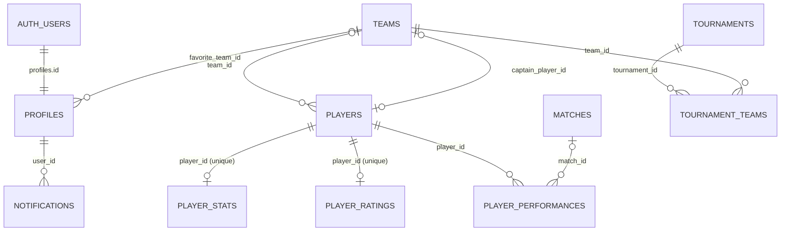
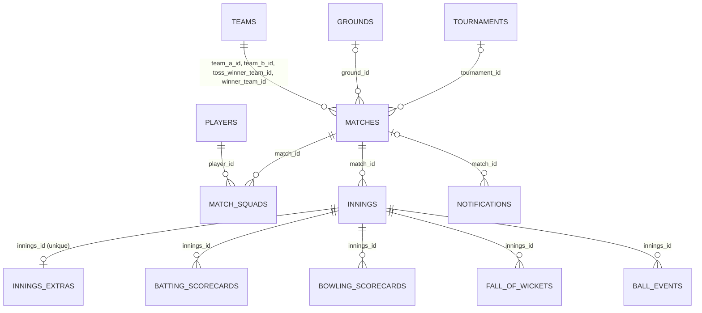

# FAQ Sports — Database Schema

**Last updated:** 2026-11-19 — from the Supabase `public` schema export supplied by the project owner (saved as [`supabase-schema.sql`](supabase-schema.sql)) and the owner's query results for enums, delete rules, RLS policies and triggers (§7), compared with client code at commit `1f86ac9`.

Related: [API_DOCUMENTATION.md](API_DOCUMENTATION.md) · [AUTHENTICATION.md](AUTHENTICATION.md) · [BUSINESS_LOGIC.md](BUSINESS_LOGIC.md)

> **Verified:** columns, keys, enum values, `ON DELETE` rules, RLS policies and triggers (§7).
> **Still unknown:** which tables have RLS switched on, the body of the `handle_new_user()` sign-up trigger, and indexes (§8).

## 1. Tables

20 tables in `public`, plus Supabase's `auth.users`. All primary keys are `uuid` with `gen_random_uuid()` (except `profiles.id`, which is the auth user ID). Every table has `created_at`; most have `updated_at`, maintained by triggers (§7.4).

| Area | Table | Used by the app today |
|------|-------|-----------------------|
| Users | `profiles` | Read `role` by email |
| | `notifications` | No (app uses mocks) |
| Teams and players | `teams` | Read, insert, delete |
| | `players` | Read, insert |
| | `player_stats` | Insert only |
| | `player_ratings` | No (app hard-codes 50) |
| | `player_performances` | No (app returns `[]`) |
| Venues | `grounds` | Read names, insert |
| Tournaments | `tournaments`, `tournament_teams` | No |
| Matches | `matches`, `match_squads` | No (`getMatches` exists, never called) |
| Cricket scoring | `innings`, `innings_extras`, `batting_scorecards`, `bowling_scorecards`, `fall_of_wickets`, `ball_events` | No |
| Table tennis | `table_tennis_matches` (added by `supabase/migrations/20261123000000_table_tennis_matches.sql`) | Read, insert, update, delete. One row per match; `points` and `game_setups` are JSONB. Select for signed-in users; writes for admins only |

The code also references a table **`ball_info`, which does not exist**. The real ball table is `ball_events` (§5).

## 2. Relationships

### 2.1 People, teams and players



There is no link between `profiles` and `players`, so the app can't tell which player a signed-in user is ([REQUIREMENTS.md open question 12](REQUIREMENTS.md#7-open-questions)).

### 2.2 Matches and scoring



`innings`, scorecards and ball events also reference `players` (striker, non-striker, bowler, dismissed by, caught by, run out by, fielder).

The database layout mirrors the app's in-memory `CricketMatch` type, split into normalised tables:

| App type (`sports/cricket/types.ts`) | Table |
|---------------------------------------|-------|
| `CricketMatch` | `matches` |
| `playingXI_*`, `substitutes_*` | `match_squads` |
| `CricketInnings` | `innings` |
| `CricketExtras` | `innings_extras` |
| `BatsmanScore` | `batting_scorecards` |
| `BowlerStats` | `bowling_scorecards` |
| `FallOfWicket` | `fall_of_wickets` |
| `BallEvent` | `ball_events` |

## 3. Users

### `profiles`

| Column | Type | Null | Notes |
|--------|------|------|-------|
| `id` | uuid | PK | = `auth.users.id` |
| `full_name` | text | yes | Sign-up sends `full_name` as auth metadata; the `handle_new_user()` trigger probably copies it here (§7.4) |
| `avatar_url` | text | yes | Not used |
| `favorite_team_id` | uuid → `teams` | yes | Not used |
| `role` | text | yes | App expects `'admin'` or `'player'`. No check constraint, so any text is accepted. **Users can update their own row, including `role`** (§7.3) |
| `email` | text | yes | App looks up the role by this column. Not unique |

### `notifications`

| Column | Type | Null | Notes |
|--------|------|------|-------|
| `user_id` | uuid → `profiles` | no | |
| `title`, `message` | text | no | |
| `type` | enum `notification_type`: `match`, `tournament`, `system` | no, default `'system'` | Same values as the app type |
| `is_read` | boolean | no, default false | |
| `match_id` | uuid → `matches` | yes | |
| `tournament_id` | uuid → `tournaments` | yes | |

## 4. Teams, players, grounds

### `teams`

| Column | Type | Null | Notes |
|--------|------|------|-------|
| `name` | text | no, **unique** | A duplicate name fails with Postgres error `23505` |
| `short_name` | text | yes | |
| `color` | text | yes | Must match `#RGB` or `#RRGGBB` (check constraint) |
| `logo_url` | text | yes | |
| `captain_player_id` | uuid → `players` | yes | |
| `archived_at` | timestamptz | yes | Migration `20261124000000`. Set by `archive_team()`; teams are archived, never deleted. The app hides archived teams from pickers |

### `players`

| Column | Type | Null | Notes |
|--------|------|------|-------|
| `name` | text | no | |
| `team_id` | uuid → `teams` | yes | |
| `position` | enum `player_position`: `Batsman`, `Bowler`, `All-rounder`, `Wicketkeeper` | yes | Case-sensitive. The Add Player form accepts free text, so anything else ("batsman", "Wicket Keeper", "Captain") makes the insert fail |
| `batting_style` | text | yes | App sends `'right'` / `'left'` |
| `bowling_style` | text | yes | |
| `nickname` | text, 1–30 chars | yes | **Pending** migration `20261119000200` |
| `cover_image_key` | text, `^[a-z0-9-]{1,60}$` | yes | **Pending** migration `20261119000200`. Key of a picture bundled in the app (`constants/playerCovers.ts`), not a URL |

**No stat columns.** The app reads stats from `players` with `select *`, so every player's stats show as 0 today. Stats are in `player_stats`.

### `player_stats` (one row per player)

| Column | Type | Null |
|--------|------|------|
| `player_id` | uuid → `players`, **unique** | no |
| `matches`, `runs`, `balls`, `wickets`, `catches`, `run_outs`, `stumpings`, `highest_score`, `fifties`, `centuries` | integer, default 0 | no — **cricket** |
| `goals`, `assists`, `wins` | integer, default 0 | no — **football** (`wins` is football wins) |
| `tt_matches`, `tt_wins`, `tt_losses` | integer, default 0 | no — **table tennis**, migration `20261124000000` |
| `cricket_innings`, `cricket_dismissals`, `balls_bowled`, `runs_conceded` | integer, default 0 | no — cricket counters for averages, migration `20261124000000` |
| `batting_average`, `strike_rate`, `economy_rate` | numeric, default 0 | no |
| `best_bowling_wickets`, `best_bowling_runs` | **text** | yes |

There's no primary key; `player_id` is unique. Best bowling figures are stored as text although the app treats them as numbers. Football extras (`saves`, cards) and table tennis fields (`losses`, `points_for`, `points_against`) from the app's `PlayerStats` type have no columns.

Since migration `20261124000000` these columns are maintained by the `player_match_stats` trigger at match end: totals are added, `highest_score` and best bowling are only ever raised, and `batting_average` (runs ÷ dismissals), `strike_rate` and `economy_rate` are recomputed from the totals.

### `player_match_stats` (one row per player per finished match)

Migration `20261124000000`. Unique `(sport, match_id, player_id)`; `sport` is `cricket`, `football` or `table_tennis`; `match_id` is text (cricket matches aren't stored, so it holds the app's match id). `team_id` → `teams` (`ON DELETE SET NULL`) plus a `team_name` snapshot, so a player's runs and wickets stay with the team they played for. Cricket columns (`runs`, `balls`, `fours`, `sixes`, `batted`, `dismissed`, `wickets`, `balls_bowled`, `runs_conceded`, `catches`, `run_outs`, `stumpings`), football `goals`/`assists`, and `won` for football and table tennis. Read: everyone. Write: only through `record_match_stats()` (admins).

### `sport_awards` and `sport_award_recipients`

Migration `20261124000000`. Current champion (`place` 1) and runner-up (`place` 2) per sport, to a team or a player. Recipients are the players recognised, snapshotted when the award is set. Migration `20261126000000` (**not applied yet**) adds `category`: `main` for cricket and football, `singles` / `doubles` for table tennis (a doubles award has two recipients); the key becomes `(sport, category, place)`. Read: everyone. Write: `set_sport_award()` / `clear_sport_award()` (admins).

### `player_ratings` (one row per player)

`player_id` (unique) → `players`; `batting`, `bowling`, `fielding`, `overall` integers, default **0**. The app doesn't create or read this row and shows 50 for everything.

### `player_performances`

Per-match player figures: `player_id`, optional `match_id`, `performance_date`, `runs`, `balls`, `wickets`, `catches`, `run_outs`, `stumpings`, `notes`. Matches the app's "last five performances" (`PerformanceSummary`) except `overs` and `opponent`, which would come from the match.

### `grounds`

| Column | Type | Null | Notes |
|--------|------|------|-------|
| `id` | uuid | PK | The app never reads it |
| `name` | text | no, **unique** | The app identifies grounds by name |
| `location` | text | yes | Written, never read |

## 5. Matches and cricket scoring

### `matches`

| Column | Type | Null / default | App field |
|--------|------|----------------|-----------|
| `sport` | text | `'cricket'` | `sport` |
| `status` | enum `match_status`: `upcoming`, `live`, `completed`, `abandoned` | `'upcoming'` | `status` (app uses `cancelled`, not `abandoned`; D15) |
| `match_type` | enum `match_type`: `short`, `long` | `'short'` | `matchType` (app default is `'long'`) |
| `total_overs` | integer > 0 | yes | `totalOvers` |
| `ground_id` | uuid → `grounds` | yes | `ground` (app stores the **name**) |
| `team_a_id`, `team_b_id` | uuid → `teams` | **no** | `teamA`, `teamB` |
| `toss_winner_team_id` | uuid → `teams` | yes | `tossWinner` |
| `toss_decision` | enum `toss_decision_type`: `bat`, `bowl` | yes | `tossDecision` |
| `current_innings` | integer > 0 | 1 | `currentInnings` (no upper limit, so super overs fit) |
| `winner_team_id` | uuid → `teams` | yes | `winner` (null allows a tie) |
| `result_text` | text | yes | `result` |
| `tournament_id` | uuid → `tournaments` | yes | — |
| `scheduled_at`, `started_at`, `completed_at` | timestamptz | yes | `startedAt`, `completedAt` (app has no scheduled time) |

There is **no `name` column**, although `getMatches` logs `row.name`.

### `match_squads`

One row per player per match: `match_id`, `team_id`, `player_id`, `is_playing_xi` (default true), `is_substitute` (default false). There are no columns for a substitute's **can bat / can bowl** rights, which the app's `Substitute` type has. No unique constraint stops the same player being added twice.

### `innings`

`match_id`, `innings_number`, `batting_team_id`, `bowling_team_id`, `runs`, `wickets`, `overs`, `balls`, and the current striker, non-striker and bowler. No unique constraint on (`match_id`, `innings_number`) is shown.

### `innings_extras`

One row per innings (`innings_id` unique): `wides`, `no_balls`, `byes`, `leg_byes`, `total`.

### `batting_scorecards`

`innings_id`, `player_id`, `batting_order`, `runs`, `balls`, `fours`, `sixes`, `strike_rate`, `is_out`, `dismissal_type` (enum `dismissal_type`, §7.1), `dismissed_by_player_id`, `caught_by_player_id`, `runout_by_player_id`. There's **no `stumped_by_player_id`**, which the app's `BatsmanScore.stumpedBy` needs.

### `bowling_scorecards`

`innings_id`, `player_id`, `overs`, `balls`, `maidens`, `runs`, `wickets`, `economy`, `wides`, `no_balls`.

### `fall_of_wickets`

`innings_id`, `player_id`, `runs_at_fall`, `over_number` (numeric, e.g. 3.4), `wicket_number`.

### `ball_events`

| Column | Type | App `BallEvent` field |
|--------|------|-----------------------|
| `innings_id` | uuid → `innings`, not null | — (app keeps balls inside the innings) |
| `over_number` | integer | `over` |
| `ball_in_over` | integer | `ball` |
| `striker_player_id`, `non_striker_player_id`, `bowler_player_id` | uuid → `players` | `strikerId`, `nonStrikerId`, `bowlerId` |
| `runs_bat` | integer | `runs` |
| `extras` | integer | `extras` |
| `extra_type` | enum `extra_type`: `wide`, `no_ball`, `bye`, `leg_bye` | `extraType` |
| `is_wicket` | boolean | `isWicket` |
| `dismissal_type` | enum `dismissal_type` (§7.1) | `wicketType` |
| `dismissed_player_id` | uuid | `outPlayerId` |
| `fielder_player_id` | uuid | — |
| `commentary` | text | — |
| `created_at` | timestamptz | `timestamp` |

## 6. Code vs database mismatches

These affect the app **today** or block the next steps. Each needs a code change, a schema change, or a decision.

| # | Mismatch | Effect | Fix needs |
|---|----------|--------|-----------|
| D1 | `getPlayers` reads stats from `players`, which has no stat columns | All player stats show 0 | Code: select `players` with `player_stats(*)` |
| D2 | `uploadBallInfo` writes to `ball_info`, which doesn't exist; payload shape doesn't match `ball_events` | Would fail if called | Code: rewrite against `ball_events` (needs an `innings_id`) |
| D3 | `players.position` is enum `player_position` (`Batsman`, `Bowler`, `All-rounder`, `Wicketkeeper`); the form sends free text | Add Player fails unless the text matches exactly, including case | Code: a picker with the four values |
| D4 | App IDs for matches are `match_<timestamp>`; DB uses uuid | Matches can't be saved as-is | Code: let the DB generate IDs |
| D5 | App stores the ground **name** on a match; DB uses `ground_id` | Needs an ID lookup | Code: `getGrounds` must return `id` too |
| D6 | `player_stats.best_bowling_wickets` / `best_bowling_runs` are text | Numeric sorting and comparison won't work | **Schema:** change to integer (recommended) |
| D7 | `match_squads` has no substitute bat/bowl rights | Rights chosen in Create Match can't be saved | **Schema:** add `can_bat`, `can_bowl` booleans |
| D8 | `batting_scorecards` has no stumped-by column | Stumpings lose the keeper's name | **Schema:** add `stumped_by_player_id` |
| D9 | Delete rules (§7.2) and delete policies (§7.3) | Team delete: only one specific user account can delete; for everyone else it silently deletes nothing. Player delete: no delete policy at all. A team that has played a match can never be deleted (`RESTRICT`) | **Decision** ([open question 13](REQUIREMENTS.md#7-open-questions)) and **RLS** changes |
| D10 | Player create doesn't create a `player_ratings` row; ratings default to 0 | Ratings would read 0, app shows 50 | Code, plus a decision on default rating |
| D11 | `profiles.role` is free text, and users can update their own row | Any signed-in user can make themselves admin (§7.3) | **Schema/RLS (urgent):** stop users changing `role`; restrict values |
| D12 | Role lookup by `profiles.email`, which isn't unique | Works only because RLS limits reads to the user's own row; `.single()` errors if that row is missing | Code: look up by `id = auth.uid()` |
| D13 | `teams.name` and `grounds.name` are unique | Duplicates fail with a generic "Failed to add" | Code: show a "name already exists" message |
| D14 | `matches.match_type` default `'short'`, app default `'long'` | Only matters if the app omits it | Pick one default |
| D15 | `match_status` has `abandoned`; the app's `MatchStatus` has `cancelled` | Saving a cancelled match would fail | Code or schema: use one word (decision) |
| D16 | `tournament_status` has `live`; the app's `Tournament.status` has `ongoing` | Tournaments would fail to save | Code: use `live` |
| D17 | `dismissal_type` has `lbw`; the app's `TypeDismissalType` and menu don't | LBW can't be recorded | **Decision:** add LBW to the app, or drop it from the enum |
| D18 | Writes the app does need policies that don't exist (§7.3): `players`, `player_stats`, grounds delete, all match tables | Those writes are rejected if RLS is on for the table | **RLS:** admin write policies |

## 7. Database rules (verified 2026-11-19)

### 7.1 Enums

| Enum | Values | Used by | App type |
|------|--------|---------|----------|
| `player_position` | `Batsman`, `Bowler`, `All-rounder`, `Wicketkeeper` | `players.position` | `string` (free text, D3) |
| `match_status` | `upcoming`, `live`, `completed`, `abandoned` | `matches.status` | `MatchStatus`: `upcoming`, `live`, `completed`, `cancelled` (D15) |
| `match_type` | `short`, `long` | `matches.match_type` | `CricketMatchType` — same |
| `toss_decision_type` | `bat`, `bowl` | `matches.toss_decision` | `TossDecision` — same |
| `extra_type` | `wide`, `no_ball`, `bye`, `leg_bye` | `ball_events.extra_type` | `BallEvent.extraType` — same |
| `dismissal_type` | `bowled`, `caught`, `run_out`, `lbw`, `stumped`, `retired`, `hit_wicket` | `ball_events`, `batting_scorecards` | `TypeDismissalType` — no `lbw` (D17) |
| `notification_type` | `match`, `tournament`, `system` | `notifications.type` | same |
| `tournament_status` | `upcoming`, `live`, `completed` | `tournaments.status` | `Tournament.status`: `ongoing` instead of `live` (D16) |

`matches.sport` and `tournaments.sport` are plain text, not an enum. The app's `SportType` values are `cricket`, `football`, `table_tennis`, `badminton`, `carrom`, `uno`.

### 7.2 Delete rules

What happens to referencing rows when a row is deleted:

| Deleting a… | Cascades (rows deleted) | Set to null | Blocks the delete (`RESTRICT`) |
|-------------|-------------------------|-------------|-------------------------------|
| **auth user** | `profiles` → that user's `notifications` | | |
| **team** | `tournament_teams`, `match_squads` rows for the team | `players.team_id`, `profiles.favorite_team_id`, `matches.toss_winner_team_id`, `matches.winner_team_id` | `matches.team_a_id` / `team_b_id`, `innings.batting_team_id` / `bowling_team_id` |
| **player** | `player_stats`, `player_ratings`, `player_performances`, `match_squads`, **`batting_scorecards`**, **`bowling_scorecards`**, **`fall_of_wickets`** | `teams.captain_player_id`, innings current striker/non-striker/bowler, scorecard dismissed/caught/run-out-by, all `ball_events` player columns | |
| **match** | `match_squads`, `innings` (→ extras, scorecards, fall of wickets, ball events), `player_performances`, `notifications` | | |
| **ground** | | `matches.ground_id` | |
| **tournament** | `tournament_teams`, `notifications` | `matches.tournament_id` | |

What this means:

- **Team delete** keeps the players and unassigns them, as the app's confirm text says. It is blocked once the team has played a saved match.
- **Player delete** also deletes that player's rows from past scorecards, so old match scorecards stop adding up to the match total. Consider blocking or soft-deleting players who have played ([REQUIREMENTS.md open question 18](REQUIREMENTS.md#7-open-questions)).

### 7.3 Row Level Security policies

`{public}` covers both signed-out (`anon`) and signed-in users.

| Table | Read | Insert | Update | Delete |
|-------|------|--------|--------|--------|
| `profiles` | own row | own row | **own row, any column** | — |
| `notifications` | own | own | own | — |
| `teams` | everyone | any signed-in user | — | **one hard-coded user ID only** |
| `grounds` | everyone (two duplicate policies) | any signed-in user | — | — |
| `players` | everyone | — | admins (`20261119000100`) | admins — migration `20261125000000`, **not applied yet** |
| `player_stats`, `player_ratings` | everyone | — | — | — (rows go with the player through cascades) |
| `matches`, `match_squads`, `innings`, `innings_extras`, `batting_scorecards`, `bowling_scorecards`, `fall_of_wickets`, `ball_events` | everyone | — | — | — |
| `tournaments`, `tournament_teams` | everyone | — | — | — |
| `player_performances` | no policy | — | — | — |

"—" means no policy. If RLS is on for that table, the operation is denied: inserts fail with error `42501`; updates and deletes don't error, they just affect 0 rows. Whether RLS is on for each table is **Unknown** (§8).

Findings:

| # | Finding | Severity |
|---|---------|----------|
| R1 | **Any signed-in user can make themselves admin.** "Users update own profile" has no column restriction, so `update profiles set role = 'admin' where id = auth.uid()` succeeds. "Users insert own profile" also lets a user create their row with `role = 'admin'` if none exists. | **Critical** |
| R2 | **No policy checks the admin role.** Team and ground inserts are open to every signed-in user, including players. | High |
| R3 | **Team delete is tied to one user ID**, not the admin role. Other admins' deletes silently do nothing, and the app still says "deleted successfully". | High |
| R4 | **Everything except profiles and notifications is readable without signing in**, by anyone with the publishable key (which ships in the app). Acceptable only if this data isn't sensitive. | Medium (decision) |
| R5 | **No insert policy on `players` / `player_stats`.** Add Player can only work if RLS is off on those tables, which would mean anyone with the key can also update or delete them. | High until RLS status is known |
| R6 | Notifications: users can insert notifications for themselves only. Admin-created notifications for other users would need a different policy or a server function. | Low |

**R1 fix:** [`supabase/migrations/20261119000000_lock_profile_role.sql`](../supabase/migrations/20261119000000_lock_profile_role.sql) restricts `role` to `admin`/`player` and removes users' ability to set it (column-level grants). Written 2026-11-19, **not applied yet**; it includes pre-checks, verification and rollback.

**Player nickname and cover:** [`supabase/migrations/20261119000200_players_nickname_cover.sql`](../supabase/migrations/20261119000200_players_nickname_cover.sql) adds `players.nickname` and `players.cover_image_key`. Written 2026-11-19, **not applied yet**; needs the two migrations below/above first.

**Players update:** [`supabase/migrations/20261119000100_players_admin_update.sql`](../supabase/migrations/20261119000100_players_admin_update.sql) adds `public.is_admin()` and an admin-only UPDATE policy on `players` (needed by Change Team). Written 2026-11-19, **not applied yet**; apply the role-lock migration first.

For the remaining R2, R3 and D18 gaps (other admin write policies), a sketch for review:

```sql
-- 1. Helper: is the caller an admin? (security definer so it can read profiles)
create or replace function public.is_admin() returns boolean
language sql stable security definer set search_path = public as $$
  select exists (select 1 from profiles where id = auth.uid() and role = 'admin');
$$;

-- 2. Example admin write policy (repeat per table and operation)
create policy "Admins write players" on public.players
  for all to authenticated using (public.is_admin()) with check (public.is_admin());
```

### 7.4 Triggers

| Trigger | Table | Function | Purpose |
|---------|-------|----------|---------|
| `on_auth_user_created` | `auth.users` | `handle_new_user()` | Runs on sign-up; presumably creates the `profiles` row. Body (and the default `role`) is **Unknown** |
| `trg_<table>_updated_at` | `profiles`, `teams`, `players`, `player_stats`, `player_ratings`, `player_performances`, `grounds`, `tournaments`, `matches`, `innings`, `innings_extras`, `batting_scorecards`, `bowling_scorecards` | `set_updated_at()` | Keeps `updated_at` current; the app never needs to send it |

`handle_new_user()` is also the natural place to enforce the decided "company email only" sign-up rule: raising an exception there rolls back the sign-up.

## 8. Still unknown — queries to run

```sql
-- Is RLS switched on per table?
select tablename, rowsecurity from pg_tables where schemaname = 'public' order by 1;

-- What the sign-up trigger does (profile creation, default role)
select pg_get_functiondef('public.handle_new_user'::regproc);

-- Indexes (for performance review)
select tablename, indexname, indexdef from pg_indexes where schemaname = 'public' order by 1, 2;
```

## 9. Keeping this page current

- When the schema changes, re-export it into [`supabase-schema.sql`](supabase-schema.sql) and update the affected section here, including §7 when policies, enums or delete rules change.
- Schema changes go in `supabase/migrations/<YYYYMMDDHHMMSS>_<name>.sql`, written for review and applied by the project owner. Note in this page whether each one has been applied.
- Better: generate types (`npx supabase gen types typescript --project-id gflkukmbxjiggvobvitb > types/supabase.ts`) and keep migrations in `supabase/migrations/`. Both need the Supabase CLI and project access.
