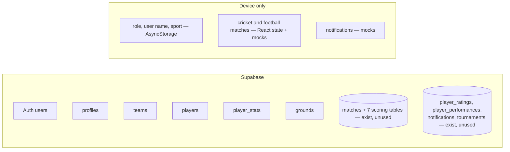

# FAQ Sports — Project Overview

**Last updated:** 2026-11-19 (from source at commit `1f86ac9`)

This is the entry point to the project docs. Everything here is derived from the code. Where the code doesn't settle a question, it is marked **Unknown** or listed as an open question in [REQUIREMENTS.md](REQUIREMENTS.md#7-open-questions).

## Documentation map

| Document | What it covers |
|----------|----------------|
| [PROJECT_OVERVIEW.md](PROJECT_OVERVIEW.md) | This page: purpose, users, feature status, where to read next. |
| [REQUIREMENTS.md](REQUIREMENTS.md) | Functional and non-functional requirements, split into implemented, partial and planned. Open business-rule questions. |
| [ARCHITECTURE.md](ARCHITECTURE.md) | Folder layout, provider tree, navigation, data flow, diagrams. |
| [DATABASE_SCHEMA.md](DATABASE_SCHEMA.md) | The real Supabase schema (20 tables), relationships, ER diagrams, code-vs-database mismatches. Raw export in [supabase-schema.sql](supabase-schema.sql). |
| [API_DOCUMENTATION.md](API_DOCUMENTATION.md) | Every function in `api/` and `sports/*/api.ts`, with request examples. |
| [AUTHENTICATION.md](AUTHENTICATION.md) | Sign-up, sign-in, roles, session handling, authorization gaps. |
| [UI_UX_GUIDELINES.md](UI_UX_GUIDELINES.md) | Colour tokens, layout patterns, interaction patterns, known inconsistencies. |
| [COMPONENTS.md](COMPONENTS.md) | Reusable components, context hooks and screens, with usage. |
| [BUSINESS_LOGIC.md](BUSINESS_LOGIC.md) | Cricket scoring engines, match setup rules, stats, known rule defects. |
| [TESTING.md](TESTING.md) | Current test setup, its state, and how to test. |
| [PROJECT_AUDIT.md](PROJECT_AUDIT.md) | Full audit with severity ratings and suggested priorities. |

Developer setup, commands and coding conventions are in [`CLAUDE.md`](../CLAUDE.md).

## 1. What it is

FAQ Sports is an internal app for **FAQ employees** to manage sports activity: players, teams, grounds, matches and scorecards. It is an Expo (React Native) app, so one codebase runs on **iOS, Android and web**. Supabase provides auth and the database.

**Status:** existing application under active development. Cricket is the most complete sport, and even cricket matches are not yet saved to the database (see [§4](#4-what-is-and-isnt-persisted)).

## 2. Users and roles

Users sign in with email and password (Supabase Auth). The role is read from the `profiles` table.

| Role | What the app lets them do today |
|------|--------------------------------|
| **Player** | View matches, live score cards, teams, players, player profiles and notifications. |
| **Admin** | Everything a player can, plus: create matches, run cricket live scoring, add and delete teams, add and delete players, add and remove stadiums. |

The role is only enforced in the app's UI. The database's access rules don't check it, and **any signed-in user can currently set their own role to admin**; see [AUTHENTICATION.md](AUTHENTICATION.md#5-authorization).

## 3. Feature status by sport

| Sport | Status | What exists in code |
|-------|--------|--------------------|
| **Cricket** | Implemented (in memory) | Create match wizard (basics, teams, toss, playing XI and substitutes), ball-by-ball live scoring, match details scorecard. |
| **Football** | Partial | Create match wizard only. "Start Now" marks the match as current but there is no scoring screen. Created matches are not listed anywhere. |
| **Table Tennis** | Implemented (saved) | Create match (singles/doubles, best of 1/3/5/7, serves per turn: 2 → games to 11, 5 → games to 21), point-by-point scorecard with serve rotation and undo, listed on Home. Saved to `table_tennis_matches` ([BUSINESS_LOGIC.md §7.2](BUSINESS_LOGIC.md)). |
| **Badminton** | Planned | Shown on Home; tapping it shows a "Coming Soon" alert. |
| **Carrom** | Planned | As above. |
| **UNO** | Planned | As above. |

Shared features:

| Feature | Status |
|---------|--------|
| Sign in / sign up | Implemented (Supabase Auth) |
| Teams: list, add, delete | Implemented; delete has bugs ([PROJECT_AUDIT.md §11.2](PROJECT_AUDIT.md#112-gaps)) |
| Players: list, add | Implemented |
| Players: delete | Broken: deletes from the wrong table |
| Players: change team | Implemented (Change Team modal) |
| Players: edit other fields | Not implemented |
| Grounds (stadiums): list, add | Implemented |
| Grounds: delete | Local only; comes back on reload |
| Player profile: ratings, last five, comments | Ratings fixed at 50, last five empty, comments not saved |
| Notifications | Mock data only |
| Tournaments | Implemented (results entered by hand); needs migration `20261128000000` |
| Leaderboards, FAQ, Terms | Implemented |
| Sport switcher | Implemented; changes the "top players" stat on Home |

## 4. What is and isn't persisted

- **Saved in Supabase:** auth accounts, roles (`profiles`, read only), teams, players, an initial zeroed `player_stats` row, grounds, table tennis matches and their point log (`table_tennis_matches`).
- **Device only, lost on reload:** cricket and football matches, live scoring state, notification read flags, player comments.
- The database already has tables for matches, squads, innings, scorecards, ball events, ratings, performances, notifications and tournaments ([DATABASE_SCHEMA.md](DATABASE_SCHEMA.md)). The app doesn't use them yet.
- Player stats are stored in `player_stats`, but the app reads them from `players`, so every stat shows 0 ([DATABASE_SCHEMA.md §6](DATABASE_SCHEMA.md#6-code-vs-database-mismatches), D1).

## 5. Main screens

| Area | Screens |
|------|---------|
| Bottom tabs | Home, Matches, Teams, Profile, More |
| Auth | Login (sign in / sign up toggle) |
| Cricket | Create Match, Live Scoring, Match Details |
| Other sports | Create Football Match, Create Table Tennis Match, Table Tennis Scorecard |
| Details | Player Profile, Team Details |
| Admin | Manage Stadiums |
| Other | Notifications |

The full route table is in [ARCHITECTURE.md](ARCHITECTURE.md#4-navigation).

## 6. Technology

| Area | Choice |
|------|--------|
| App framework | Expo SDK 54, React Native 0.81, React 19.1, react-native-web |
| Navigation | Expo Router 6 (file-based, typed routes) |
| Language | TypeScript, strict mode |
| Backend | Supabase (`@supabase/supabase-js` 2.99) |
| State | Context hooks (`@nkzw/create-context-hook`), TanStack React Query, AsyncStorage |
| Styling | `StyleSheet.create`, dark-theme tokens in `constants/colors.tsx` |
| Icons | `lucide-react-native` |
| Tests | Jest (`jest-expo`) + React Native Testing Library |

## 7. Known gaps (short list)

The full list, with severity, is in [PROJECT_AUDIT.md](PROJECT_AUDIT.md).

1. Matches and ball-by-ball data are not persisted.
2. Authorization is client-side only. Database policies don't check the admin role, and users can promote themselves to admin ([DATABASE_SCHEMA.md §7.3](DATABASE_SCHEMA.md#73-row-level-security-policies)).
3. The Supabase session is probably not persisted on iOS/Android, and logout doesn't sign out of Supabase.
4. Player delete targets the wrong table; team and stadium delete report success without confirming it.
5. Several cricket scoring rule defects, including a cosmetic Undo ([BUSINESS_LOGIC.md §6](BUSINESS_LOGIC.md#6-known-defects)).
6. Confirmation dialogs (`Alert.alert` with buttons) do nothing on web.
7. The only test cannot run ([TESTING.md](TESTING.md)).
